# ioPix

*A web companion for your digiKam library.*

A web front end for a digiKam library, for browsing, searching and managing photos from any browser: FastAPI + a single-page vanilla JS app. It reads digiKam's database and your photos, keeps everything it builds in its own `data/` folder, and writes to the library only for the editing features you turn on.

You don't need digiKam to use it: point it at a folder of photos and it keeps the library itself (see [Working without digiKam](#working-without-digikam)).

## What it does

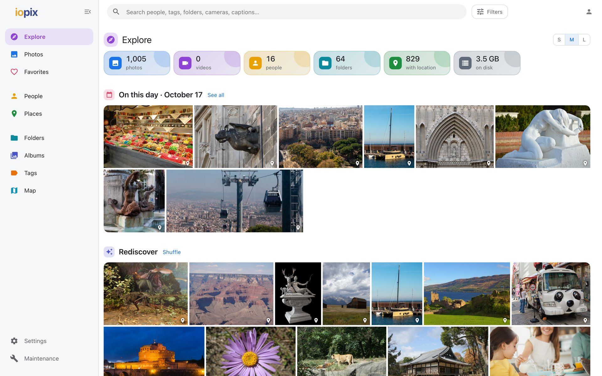

| | |
| --- | --- |
| 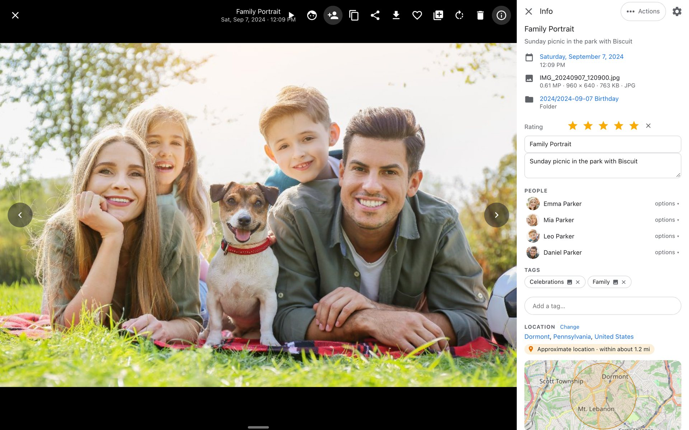 | 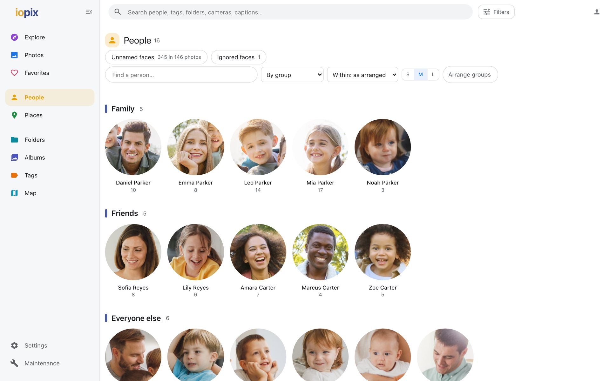 |
| **Viewer** with the info panel: rating, caption, faces, tags, location | **People** from digiKam's face regions |
| 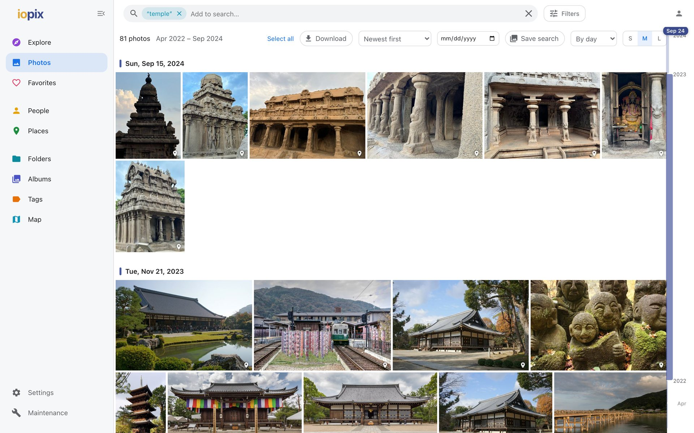 | 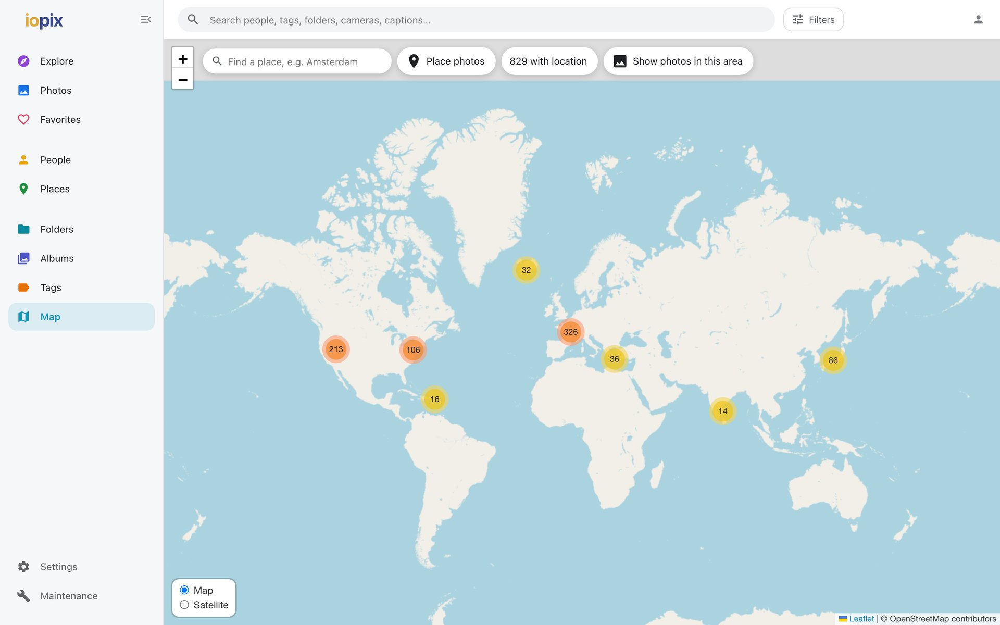 |
| **Search** by what is in the photos | **Map** of every geotagged photo |
| 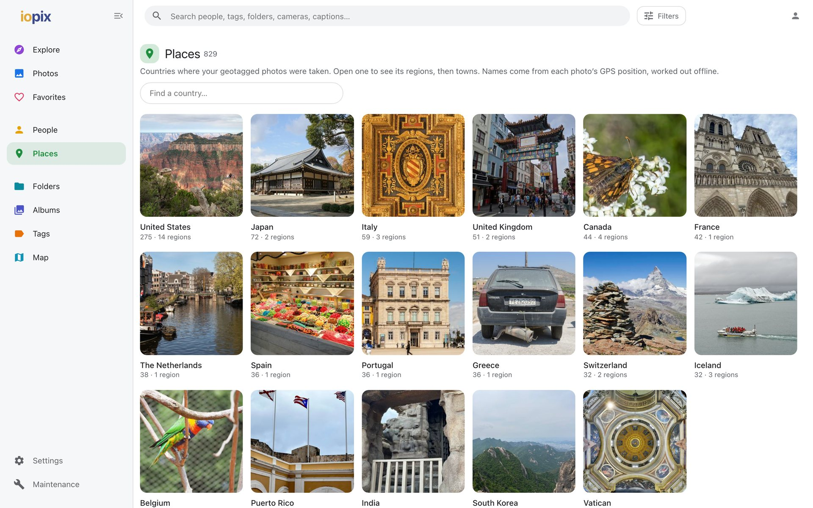 | 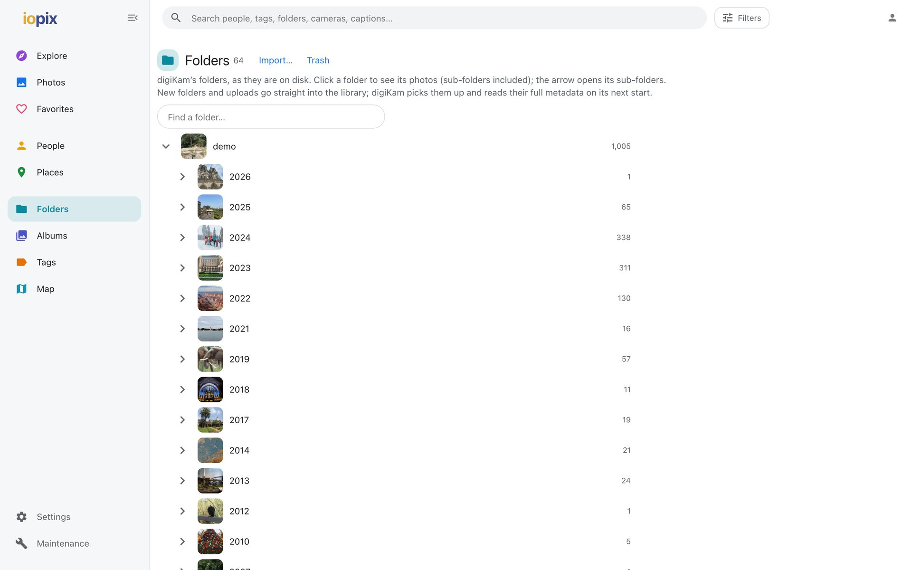 |
| **Places** worked out offline from GPS positions | **Folders** as they are on disk |
| 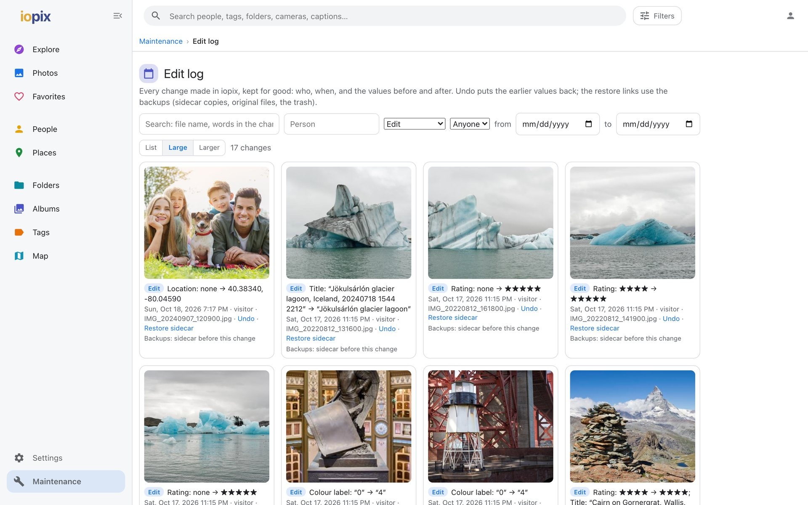 | 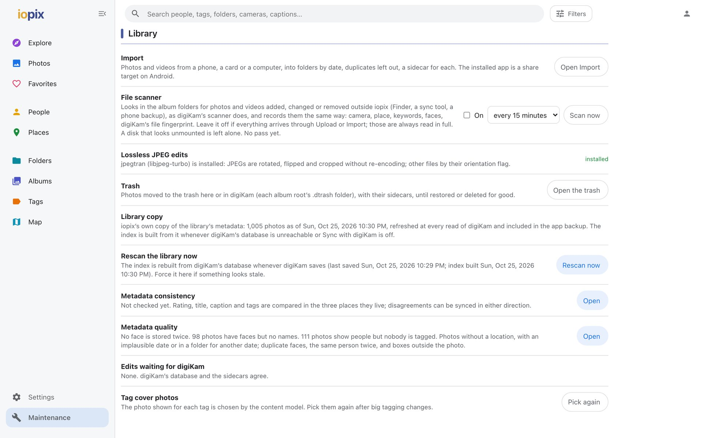 |
| **Edit log** with undo for every change | **Settings › Library** |

<p>
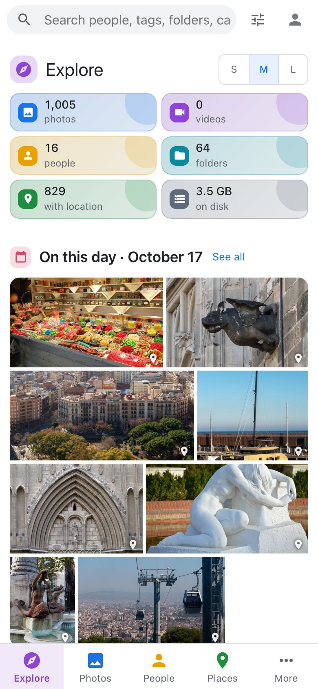

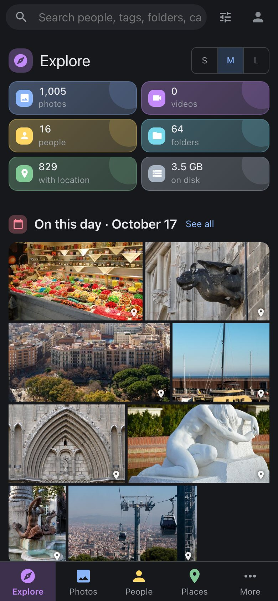
</p>

## Run

ioPix is one of the apps of [ioSuite](../README.md), one program that runs the apps it is told to. Install the suite
with ioPix in it, alone or with the others, on any Linux machine:

```sh
curl -fsSL https://raw.githubusercontent.com/avandeputte/iosuite2/main/install.sh | bash -s -- --apps iopix
```

It asks for the MariaDB server, the first admin and the suite's address, and for ioPix the folder with the photos and,
when you use digiKam with them, the folder of its database; then it starts the service. Leave `--apps` out for the
list of every app, to tick. On a server that already runs the suite:

```sh
iosuite install --add iopix          # --remove iopix stops running it; what it stored stays
iosuite install --extras iopix-ai    # the packages of the AI features: content search, text in photos, objects and faces
```

In Docker, the stack file ([docker-compose.yml](../docker-compose.yml)) mounts the photos folder at `/library/photos`,
and the image tagged `ai` has the AI packages (amd64 only). On Proxmox VE the container's script asks for the photos
folder and binds it into the container. The guide has each way in full:
[any Linux or Mac](../docs/docs/start/linux-mac.md), [Docker](../docs/docs/start/docker.md), [Proxmox VE](../docs/docs/start/proxmox.md)
and [one app or all of them](../docs/docs/start/one-or-all.md).

ioPix can run in a copy of the program of its own (a second service on the same machine, a container of its own,
another server), so that a scan of a large library never slows the other apps; it stays one suite, reached at the same
addresses: [Several copies and several servers](../docs/docs/start/several-apps.md).

| | |
| --- | --- |
| Address | `/pix/` at the suite's address (`https://home.example.com/pix/`), and a name of its own if you give it one |
| Devices | scripts with an app password at `/pix/api/…`, at the [address for devices](../docs/docs/reference/configuration.md#the-three-ports); the iPhone, iPad, Mac and Apple TV apps show ioPix's own pages, so they take the pages' address |
| MCP | `/pix/mcp` at the address for MCP ([AI assistants](../docs/docs/run/assistants.md)) |
| Database | `iopix`, beside the Shared ioSuite database (the accounts and every setting), both under the suite's one login; the tables are made on the first start and brought up to date by later versions by themselves |
| On the server | exiftool (metadata editing), ffmpeg (video thumbnails), `jpegtran` from libjpeg-turbo (lossless rotate and crop), libheif and the MariaDB client (the backups of digiKam's database); the installer, the Proxmox script and the container image have them |

With nothing set, ioPix starts on a library of its own: no digiKam, the photos in a folder beside its data. The
settings `PHOTOS_ROOT`, `DIGIKAM_DB_TYPE` and `DIGIKAM_DB_DIR` (below) name the real ones; the installer stores what
you answer.

- **Models** are not part of the program. Turn a feature on under Settings › AI and its model is downloaded into
  ioPix's data folder (`iopix/models` in the machine's `DATA_DIR`; on the `/data` volume in a container, so a new image
  does not fetch them again), or name them in the setting `AUTO_MODELS` (`siglip2,yolox,geonames`, about 1.6 GB) and
  they are fetched one after another at the next start, the library browsable meanwhile. From a shell:
  `.venv/bin/python -m iopix.ai.models download <key>` (the keys are those of Settings › AI: `clip`, `siglip2`,
  `jinaclip`, `blip`, `blip_large`, `florence2`, `yolox`, `yolox_m`, `yolox_l`, `yolox_x`, `yunet`, `scrfd`,
  `retinaface`, `sface`, `arcface`, `aesthetic`, `eyes`, `mivolo`, `geonames`, `ocr`).
- **Editing** needs the photos folder writable by the account the suite runs as (uid 1000 in a container): sidecars
  are written next to the photos, and in-file writing rewrites the photos themselves.
- **Writing digiKam's database** ("Apply to digiKam database", tag manager, faces, place tags, badges, new folders
  and uploads) needs the digiKam folder writable too when digiKam uses SQLite. With MySQL or MariaDB there is no
  folder; `mariadb-dump` takes the backup before each write, or `DIGIKAM_DB_DUMP` names a command that does.
- **In a container**, or with digiKam on another machine, ioPix cannot see whether digiKam is open: the stack file
  sets `DIGIKAM_CHECK=none`, and no check is made before a database write. Changes made in ioPix and in digiKam at
  the same moment to the same photo can overwrite each other; on MariaDB the database itself stays consistent.

Accounts are the suite's: `iosuite admin NAME --app iopix` makes someone an admin of ioPix only (`iosuite admin NAME`: of
the whole suite), `iosuite password NAME` sets a password; see [Accounts and roles](../docs/docs/run/accounts.md).

## Configuration

ioPix has no file of settings. The machine's one file (`config.env` in the program folder) says how to reach the Shared
ioSuite database and which apps run here; everything else is kept in that database. Suite admins change it under
**Settings › Global settings › Settings**, which has a section for the whole suite and one for ioPix, or from a shell;
a change applies when the app starts again:

```sh
iosuite settings iopix        # what may be set, with the value stored now
iosuite set iopix PUBLIC_URL https://photos.example.com    # no value: back to the default
```

| Setting | Meaning |
| --- | --- |
| `PUBLIC_URL`, `SYNC_URL`, `MCP_URL` | an address of its own for the pages, for devices and for MCP clients (`https://photos.example.com`), beside its folder at the suite's address |
| `DATA_DIR` | where the app writes on its own (`iopix/` in the machine's `DATA_DIR`) |
| `DB_NAME` | the name of its database (`iopix`) |
| `PHOTOS_ROOT` | photos folder. Where the photos are, when the library has a single album root. Empty: a folder named photos in the data folder |
| `DIGIKAM_DB_TYPE` | digiKam database (`none`). none: no digiKam at all, ioPix keeps the library itself. sqlite: digikam4.db in the folder below. mysql: the server below |
| `DIGIKAM_DB_DIR` | folder with digikam4.db |
| `DIGIKAM_DB_HOST` | digiKam MySQL host (`127.0.0.1`) |
| `DIGIKAM_DB_PORT` | digiKam MySQL port (`3306`) |
| `DIGIKAM_DB_NAME` | digiKam MySQL database (`digikam`) |
| `DIGIKAM_DB_USER` | digiKam MySQL user (`digikam`). Its password is set in ioPix under Settings › Library › digiKam database |
| `DIGIKAM_DB_BACKUP` | back up digiKam's database before destructive operations (`auto`) |
| `DIGIKAM_DB_DUMP` | command that dumps digiKam's MySQL database. Used instead of mysqldump, e.g. through docker exec |
| `DIGIKAM_CHECK` | how to tell that digiKam is closed (`pgrep`). none: digiKam runs on another machine and cannot be seen |
| `DIGIKAM_MYSQL_DATES` | dates in a MySQL digiKam library. Empty: detected |
| `SIDECAR_COMPAT` | name new sidecars photo.xmp (`1` or `0`; off by default) |
| `EDITING` | allow metadata edits (`1` or `0`; on by default) |
| `DB_WRITE` | allow “Apply to digiKam database” (`1` or `0`; on by default) |
| `PREWARM` | build all grid thumbnails in the background (`1` or `0`; on by default) |
| `SEMANTIC` | search by content (`1` or `0`; on by default) |
| `ANALYSIS` | analyse photos in the background (`1` or `0`; on by default) |
| `CAPTIONS` | describe every photo in a sentence (`1` or `0`; on by default) |
| `AUTO_MODELS` | models to download when missing. For example siglip2,yolox,geonames |
| `BG_THREADS` | cores a background job may use. Empty: half the machine |
| `PREWARM_WORKERS` | threads for thumbnails. Empty: the cores above |
| `ANALYSIS_WORKERS` | threads for analysis. Empty: the cores above |
| `JOBS_PROCESS` | run AI jobs in a process of their own (`1` or `0`; on by default) |
| `JOBS_MEMORY_MB` | most memory the job process may hold (MB). Empty: 60% of the machine's. 0: no limit |
| `MEMORY_RESERVE_MB` | free memory the server keeps (MB). Empty: 8% of the machine's |
| `THUMB_HEIGHT` | thumbnail height (`360`) |
| `THUMB_MAX_WIDTH` | thumbnail width at most (`1080`) |
| `THUMB_QUALITY` | thumbnail quality (`76`) |
| `PREVIEW_SIZE` | preview size (longest edge) (`2560`) |
| `PREVIEW_QUALITY` | preview quality (`86`) |
| `PREVIEW_CACHE_MAX_MB` | preview cache at most (MB) (`8000`) |
| `VARIANT_CACHE_MAX_MB` | cut-down thumbnails cache at most (MB) (`2000`) |
| `REINDEX_POLL` | seconds between checks of digiKam's database (`20`) |
| `INDEX_PATCH` | update the search index in place after small changes (`1` or `0`; on by default) |
| `SCANNER_LOOP` | file scanner runs by itself (`1` or `0`; on by default) |
| `EXIFTOOL` | exiftool to use. Empty: the one on the PATH |

The suite's own settings (its address, the domain the sign-in is shared on, the time zone, how long deletions are kept), the
machine's file and the three ports are in the guide's [Configuration](../docs/docs/reference/configuration.md).

### Sidecar file names

digiKam writes a photo's sidecar as `photo.jpg.xmp` by default, or as `photo.xmp` with its "compatible file name" option. The viewer reads whichever exists and writes new sidecars the default way; set `SIDECAR_COMPAT=1` (or the Settings › Editing option) to write new ones as `photo.xmp`.

### Google API keys

The Google Maps key (Settings › Map provider) reaches every browser in the tile and Street View URLs, so restrict it by HTTP referrer to the viewer's address. The APIs called from the server (Geocoding, Places, Elevation, Cloud Vision) can use a second key restricted by API and IP address: enter it as the server key in the same setting; without one, the first key is used for both.

## Updates

The suite is one program with one version, so every app is updated together: **Settings › Global settings › Updates**
(suite admins, in any app) shows the installed version and the newest one, with one **Update** button; from a shell it is
`update.sh` in the program folder, and in Docker the image is pulled. See [Updates](../docs/docs/run/updates.md).

**Settings › Server** shows the version ioPix runs and has **Restart**. The log is one for the whole copy of the program,
each line marked with its app: suite admins read it under **Settings › Global settings › Logs**.

## Reverse proxy and HTTPS

ioPix is reached through the suite's three ports: the pages (80), devices (8443) and MCP (8444). A reverse proxy gives each
a name and HTTPS, for the whole suite at once, and can make people sign in first (Cloudflare Access, Authelia, oauth2-proxy):
[Reverse proxy and HTTPS](../docs/docs/run/reverse-proxy.md) and [Cloudflare Tunnel and Access](../docs/docs/run/cloudflare.md) in the
guide have the set-up, with Caddy and nginx examples, sign-in at the proxy and the optional check of app passwords at
Cloudflare's edge ([cloudflare/edge-auth](../cloudflare/edge-auth/README.md)).

HTTPS also makes the browser treat ioPix as a secure context, which "Add to Home Screen" / "Install app" and the service worker need from any machine other than localhost. The iPhone, iPad, Mac and Apple TV apps show ioPix's own pages, so they take the pages' address and sign in there; scripts with an app password use the address for devices.

## Users and permissions

Accounts are the **ioThing suite's shared accounts** in the **Shared ioSuite database** (the suite's shared library, [iosuite_shared/](../iosuite_shared/); a MariaDB database shared with ioNote, ioContact and the other apps, holding accounts, sessions, roles, the suite-wide settings and the list of apps): one name, password and session for every app, so someone signed in at `photo.example.com` is signed in at `notes.example.com` too when the apps share a domain (`COOKIE_DOMAIN`). What is iopix's own is kept per app: the role an account holds here, its display settings and the person it is linked to. A *suite admin* is admin in every app; an app admin manages this app's settings and the accounts' roles here. The machine's file (`config.env` in the program folder) says how to reach that database; its tables are created at start.

Out of the box the viewer is open to anyone who can reach it. The installer asks for the admin account; Settings offers **Create the admin account** later (or `ADMIN_USER` and `ADMIN_PASSWORD` in a container's environment, or `iosuite admin NAME` from a shell). Once a user exists:

| Who | Can |
| --- | --- |
| Not signed in | browse and search everything, read-only; display settings stay in the browser |
| **viewer** | the same, plus their display settings kept on the server; only looks |
| **member** (the default) | plus their own favorites and private albums kept on the server (they follow the user to another device) |
| **without a password** | signs in with one click from the account picker (like a media-server profile). An account with no password can never be more than a member |
| **editor** | plus every library write: edits, tags, faces, place tags, GPS tracks, metadata sync, applying to digiKam's database |
| **admin** | plus settings, maintenance, models, backups, updates and managing users (Settings › Security, for suite admins) |

**Albums are shared or private.** A shared album is seen by everyone who can browse, and only editors and admins create, rename, fill, share or delete it. A private album is seen and changed only by the account that made it, (admins do not see other people's private albums); any member, editor or admin can make one. An editor or admin can share their private album, or make a shared album private, which makes it theirs. Albums from before v1.27 are shared. With no accounts yet, every album is shared.

**Settings › Security** (suite admins) is the suite's admin panel, the same as on the start page and in every io app (iosuite_shared's `/api/suite-admin/ui.js`): people and their role in every app, app passwords, keys and tokens, the apps (default role, sign-in required) and sign-in at the proxy.

**Sign-in required** (Settings › Global settings › Apps, on by default) turns the open browsing off: visitors get the sign-in screen and nothing else; no thumbnail, preview or API answer is served without an account. An MCP client always signs in with an app password (Settings › Account › App passwords), whether or not sign-in is required: `Authorization: Bearer <app password>` (in Claude Desktop's `mcp-remote` config: `"args": ["mcp-remote", "https://…/mcp", "--header", "Authorization: Bearer <app password>"]`).

**ioPix's own database**: ioPix keeps its own data (settings, favorites, its albums, the edit log, AI results, its copy of the library) in a database of its own (`iopix`, not digiKam's; the setting `DB_NAME` names another) on the suite's MariaDB server, under the suite's one login. The installer creates it when given a MariaDB administrator; by hand: `CREATE DATABASE iopix CHARACTER SET utf8mb4 COLLATE utf8mb4_unicode_ci; GRANT ALL ON iopix.* TO 'iosuite'@'app-host';`. While that database does not answer, the web app shows only a page that says so, with Retry, and API calls answer 503 with `needsDatabase: true`.

Each account can be linked to a person from People by a suite admin (Settings › Security › People › Person in photos, in any io app: the panel reads ioPix's People through the suite's app link; an admin can also link their own account from the account dialog; the link is kept in the Shared ioSuite database). Only admins link accounts, because a linked person's face is shown on the sign-in screen. That person's face badge becomes the account's avatar in the account picker and the menu. Each account can also carry an optional email address (Settings › Security › People). A reverse proxy that authenticates users (Authelia, Authentik, Cloudflare Access…) is mapped onto these accounts by the email it passes (see Sign-in at the proxy).

Sign in from the person icon at the top right: the dialog shows a tile per account; a passwordless account signs in with one click, the others ask for their password. A suite admin can take an account off that list (Settings › Security › People › On the sign-in list, for instance the admin account itself): it then signs in through the “Other” tile, by name and password. Sessions are random tokens in an HttpOnly cookie (`iothing_session`, shared by the apps on the domain) valid for 30 days and renewed in use; Sign out ends this browser's session, and a suite admin can end all of an account's sessions under Settings › Security › People. Each session records where it began and was last seen (the visitor's address, whether it came through Cloudflare, the web app or which native app, the User-Agent): `GET /api/auth/sessions` lists your own (`DELETE /api/auth/sessions/<id>` ends one), suite admins see any account's at `GET /api/suite-admin/users/<id>/sessions`. Passwords are Argon2id-hashed and never stored in clear. The server enforces all of it: write endpoints answer 401/403 regardless of what the page shows.

## MCP server

The viewer is also an [MCP](https://modelcontextprotocol.io) server, on the suite's port for MCP (8444), at `/pix/mcp` (streamable HTTP), the same in every app of the suite, so an assistant such as Claude can search and inspect the library through the running app; nothing is installed or downloaded. It is **off by default**: switch it under Settings › Server › MCP server; while off, `/mcp` answers 404. Every assistant signs in with an **app password** (Settings › Account › App passwords), as HTTP Basic or `Authorization: Bearer <app password>`, and acts as that account. The library tools are read-only and answer any account (they show what that account sees in the web app): `library_overview`, `search_photos` (every filter the web app has, plus `looks_like` text and `similar_to` a photo), `count_by`, `get_photo`, `list_people`, `list_tags`, `list_albums`, `list_places`, `list_app_albums`, `find_duplicates` and `view_photo` (the picture itself); results carry links into the viewer (`PUBLIC_URL`). The tools for operating it take an admin, because they reveal paths, log lines and settings or change the library: `diagnostics` (version, platform, database, external tools, disk, job queue, models, settings without secrets), `server_log` (ioPix's lines of the copy's log, filterable), `job_queue`, `photo_file` (one photo's files, sidecar, cache and backups), and the maintenance tools (reports, suggestions, edits and jobs the web app's pages offer). Treat an admin's app password as a secret, and revoke it when in doubt.

    claude mcp add --transport http iopix http://<server>:8444/pix/mcp --header "Authorization: Bearer <app password>"
    claude mcp add --transport http iopix https://mcp.example.com/pix/mcp --header "Authorization: Bearer <app password>"    # behind the reverse proxy

**Claude Desktop on another computer** (same network): Claude Desktop's "custom connectors" are reached from Anthropic's servers, so a LAN address cannot be added there. Use the `mcp-remote` bridge in its local configuration instead, which needs Node.js on that computer. Edit `claude_desktop_config.json` (macOS: `~/Library/Application Support/Claude/`, Windows: `%APPDATA%\Claude\`), replacing the address with the viewer's host name or IP, then restart Claude Desktop:

    {
      "mcpServers": {
        "iopix": {
          "command": "npx",
          "args": ["-y", "mcp-remote", "https://mcp.example.com/pix/mcp",
                   "--header", "Authorization: Bearer <app password>"]
        }
      }
    }

That is the form behind the reverse proxy; without one, use `http://<server>:8444/pix/mcp` and add `"--allow-http"` to the arguments, since the suite itself speaks plain HTTP. The tools then appear in Claude Desktop's tool menu. Every request signs in, so behind the HTTPS proxy the endpoint can be reached from outside the home network.

Other clients that take an MCP URL use `http://<server>:8444/pix/mcp` directly (set `PUBLIC_URL` if links in results should use a different address). Clients that only spawn stdio servers on the machine running the viewer can use `.venv/bin/python -m iopix.mcp --user NAME` (or the setting `MCP_USER`) in the program folder; it is the same code, acting as that account.

## Optional features

All chosen under Settings › AI; each is a package (`iosuite install --extras iopix-ai` installs them; the container image tagged `ai` has them) plus a model downloaded into ioPix's data folder:

| Feature | What it adds | Download |
| --- | --- | --- |
| Content search | find photos by what is in them; "Detected content" | SigLIP 2 base ~1.5 GB, CLIP ViT-B/32 ~600 MB or Jina CLIP v1 ~900 MB |
| Places | town, region, country for GPS positions, offline | GeoNames ~30 MB |
| Object detection | people, animals, vehicles, everyday objects with boxes | YOLOX-S 35 MB (or M 101 MB, L 217 MB, X 396 MB) |
| Text in photos | signs, jerseys, documents searchable | RapidOCR ~60 MB |
| Face grouping | look-alike unnamed faces grouped, with "looks like" name suggestions | SFace 37 MB (or ArcFace ResNet-50 174 MB) |
| Face detection | faces nothing has marked yet, added as unnamed faces (on request) | YuNet 0.2 MB (or SCRFD 10G 17 MB, RetinaFace ResNet-50 104 MB) |
| Photo descriptions | one sentence per photo (BLIP) or a short paragraph (Florence-2), searchable | BLIP base ~950 MB (or BLIP large ~1.9 GB) plus PyTorch (CPU build ~1 GB), or Florence-2 base ~1.1 GB without PyTorch |
| Photo quality | an aesthetic score, "Best looking first", a better best frame per burst | LAION aesthetic predictor on CLIP ViT-L/14 ~1.2 GB |
| Closed eyes | closed eyes on faces seen from the front, for likely rejects and bursts | ViT eye-state classifier 343 MB (plus a face detection model) |
| Date suggestions | a year for photos marked "Date unknown", from the ages of the named people in them | MiVOLO v2 age ~118 MB |

Where a feature can run on more than one model, the default is the small, fast one and the menu in the Model column of Settings › AI switches to a larger, more accurate one (downloaded once; the sizes and speeds are shown there):

| Feature | Default | Alternatives | What changes when you switch |
| --- | --- | --- | --- |
| Content search | CLIP ViT-B/32 (SigLIP 2 on new installs) | SigLIP 2 base (generally more accurate, 4x slower to index), Jina CLIP v1 (longer, more natural queries, 3x slower) | the library is indexed again with the new model in the background; search stays on the old index until that finishes |
| Object detection | YOLOX-S (40 AP on COCO) | YOLOX-M (47 AP, 3x slower), -L (50 AP, 6x), -X (51 AP, 10x) | new photos use it at once; "Run again" redoes the whole library |
| Face detection | YuNet (80% on the hard WIDER Face set) | SCRFD 10G (95%, 10x slower; InsightFace), RetinaFace ResNet-50 (84% hard, the slowest) | the next detection run uses it |
| Face grouping | SFace (128-d, on the raw crop) | ArcFace ResNet-50 (512-d, WebFace600K; InsightFace), each face aligned on its eyes, nose and mouth first with the chosen face detector; much better at telling people apart (on a sample of confirmed faces, mean cosine similarity: same person 0.71 vs different people 0.05, where SFace gives 0.75 vs 0.38), 5x slower | every face is embedded again in the background |
| Photo descriptions | BLIP base | BLIP large (richer sentences, 3x slower), Florence-2 base (a short paragraph per photo, far more searchable detail; CPU only, no PyTorch, several times slower than BLIP base) | new photos use it at once; "Run again" redoes the whole library |

SCRFD and ArcFace come from InsightFace's `buffalo_l` pack (a 289 MB zip); only the one file each needs is kept.

## Browsing

The viewer is a web app that installs like an app on a phone or tablet (PWA): open it in the browser and choose "Add to Home Screen" (iOS Safari) or "Install app" (Android Chrome, desktop Chrome/Edge). The layout adapts to narrow screens: the top bar and dialogs stay clear of the notch and the home indicator, the bottom bar carries Photos, Explore, People and Search with the rest (Favorites, Folders, Albums, Tags, Places, Settings) under More, dialogs open as sheets from the bottom, the selection bar shows its actions as icons, and photos are swiped through; a service worker keeps the app shell available, but photos and search always come from the server, so nothing shown is ever stale. Settings › Name sets what the viewer calls itself (the top bar, the tab title and the installed app's name; the default is iopix).

- **Photos**: the whole library as one virtualised timeline grouped by day, with a year scrubber, three tile sizes and several sort orders.
- **Search**: instant suggestions for people, tags, albums, cameras, lenses, photographers, places, years and months; Enter for full-text search across file names, albums, titles, captions, tags, people, recognised text and descriptions. Every pick becomes a chip; chips combine. With content search on, "Photos that look like…" searches by description.
- **Filters**: every piece of metadata for the current results with live counts: type, rating, date range, years, people, tags, albums, location, camera, lens, ISO / aperture / focal length, photographer, file type, plus the analysis filters below.
- **Explore, People, Folders, Albums, Tags, Places, Map**: face-crop avatars from digiKam's face regions, the folder tree (digiKam's albums on disk; editors can create folders and upload photos into them, which digiKam then scans fully on its next start), the viewer's own albums (groupings that live only in the viewer), the full tag tree, places from country to town, and a clustered map of geotagged photos ("Day's trail" draws a day's route).
- **Explore** also lists: Duplicate files (byte-identical files, by digiKam's content hashes), Bursts & best shots, Events & trips, Detected content, Edited here not yet in digiKam.
- **Viewer**: zoom and pan (switches to the original file when zoomed in), keyboard and swipe navigation, a film strip of the neighbouring photos along the bottom edge, slideshow, face boxes, object boxes, video playback, download, Share (the device's own share sheet with the picture attached where the browser has one, else a menu with the links) and an info panel with all metadata, each value a link to matching photos: your own title and caption first, then date, file, people, tags and location; the camera, lens and exposure low in the panel in small type; everything the models produced (description, detected content, objects, text, sharpness, similar photos) together at the end under "AI analysis". Settings › Display › Info panel, or the gear at the top of the panel, chooses which sections show, saved with the account.
- **Appearance**: Settings › Display chooses light, dark or the device's theme and whether thumbnails carry badges (faces, GPS, favorite); saved with the account when signed in, else in the browser. Following the device is the default. Units (Automatic, Kilometres or Miles) are saved the same way.
- **Smart albums**: any filter combination can be saved from the bar above the grid ("Save search") and appears under Albums as a smart album that updates itself; the timeline rail on the right shows a density ribbon (how many photos each month has), a marker naming the month you are at, and on hover a preview of that month with a few thumbnails; it also shows months when the list spans a few years, and a date box in the bar jumps to a day.
- **Keyboard tagging in the viewer**: 0–5 rate, L favorites, T opens the tag dialog (recent tags first), P names the next unnamed face (or lets you draw one), F/O toggle faces and objects, I the info panel.
- **Similar photos** (Explore › Duplicate files): resized, re-saved or burst-neighbour copies found from the content-search embeddings at a chosen strictness, sharpest copy first; the byte-identical sets stay above it. Nothing is ever deleted by the viewer.
- **Face grouping and suggestions** (People › Faces › Unnamed faces): with the SFace model (Settings › AI, 37 MB) the unnamed faces digiKam found are shown in look-alike groups, each named or ignored in one go, and each group or face carries the viewer's own "looks like" guess (from the most recent confirmed faces of every named person) with a one-click name. A guess is written nowhere until you accept it.
- **Select, favorite, collect**: hover a tile and click its check mark (shift-click for a range, the check on a day header for the whole day, or "Select all"). The selection bar can favorite, add to an app album, tag, edit, set a location or download. Favorites and "My albums" live in iopix's own database, never in digiKam.
- **Download as zip**: "Download" zips the originals of the current search, album or selection, keeping the album folder structure, optionally with XMP sidecars, streamed without temp files. The whole library is never offered as one download. Large downloads are split into parts of 1, 2, 4 or 8 GB (2 GB by default; the API accepts `part_mb` from 100 to 16000) that unzip into one folder.

## AI analysis and background jobs

All analysis runs locally and is stored in iopix's own database; nothing is written to digiKam. New and changed photos are picked up automatically (the digiKam database is polled every `REINDEX_POLL` seconds, 20 by default). Settings › AI shows every job with progress, "Check for new photos now" and "Run again from scratch".

Heavy work runs through one queue, one job at a time, in this order: thumbnails, sharpness/exposure/objects, content-search embeddings, text and face quality, face grouping, similar photos (when asked for), descriptions, photo quality, ages for date suggestions. Each job may use `BG_THREADS` cores (default half the machine, changeable in Settings; a change applies when the next job starts), so the viewer and other apps stay responsive.

The jobs that load models do their work in a process of their own, started when the first one needs it and ended when the queue is empty (which also hands the models' memory back). The web app watches it once a second against the server's memory limit (the container's, where there is one): a job that takes more than its share (`JOBS_MEMORY_MB`, 60% of the limit by default), or that runs while the server has less than its reserve free (`MEMORY_RESERVE_MB`, 8%), is stopped before the system has to stop something itself, and no job starts while memory is that short. The web app stays up either way. A stopped job is tried once more and goes on from what it had finished; stopped a second time it is paused, and Settings › AI says why and offers "Try again". The same page shows the memory in use and the last job that was stopped.

| Job | What you get |
| --- | --- |
| Sharpness and exposure | measured on a ~1000 px decode: Sharpest / Blurry / Very dark / Very bright filters, "Sharpest first" sort; sharpness shown as a rank within your library |
| Object detection | YOLOX (S by default; M, L or X as an option), 80 everyday object types with boxes; Objects and "people in the picture" filters; O in the viewer |
| Content search | SigLIP 2, CLIP or Jina CLIP embeddings: text search by description, "More photos like this", Detected content, tag cover photos |
| Text in photos and face quality | RapidOCR text, searchable from the search box and kept to what reads as words (numbers, words in the English, French, Dutch or German word lists, the library's own names, titles and places, and words read in three or more photos; misreadings like "NIVHITY" are left out, the text as read stays stored); face quality as the sharpness of digiKam's face regions. |
| Face grouping and suggestions | SFace (or ArcFace, aligned on the landmarks) embeddings of every face that has no name yet (whoever marked it) and of each person's recent confirmed faces: look-alike groups on People › Faces with a "looks like" suggestion and one-click naming |
| Face detection | YuNet (OpenCV, 0.2 MB, onnxruntime; or SCRFD 10G or RetinaFace ResNet-50, chosen in Settings › AI) finds faces nothing has marked yet, on request only: a photo (info panel › People › detect faces), a folder (the face button on its row in Folders, subfolders included) or the whole library (Settings › AI › Run). Every existing face region, named, unknown, suggested or ignored, from digiKam or any other tool, is honoured: a detection that overlaps one (centre inside it, or a third of the smaller box covered) is the same face and is not added, even when the rectangles differ. New faces are written to digiKam's database the way digiKam writes an unnamed face, so they appear under People › Unnamed faces with a "looks like" suggestion. The library run remembers which photos it looked at and next time checks only new and changed ones; "Run again" looks at every photo again |
| Photo descriptions | one sentence per photo from BLIP base (or BLIP large), through PyTorch on an Apple GPU when there is one, else on the CPU; or a short paragraph from Florence-2 base (Microsoft; onnx-community's ONNX export, greedy decoding of its most detailed caption task, onnxruntime on the CPU). Searchable and shown in the info panel. Text in photos stays with RapidOCR (Florence-2's own text reading runs words together). `CAPTIONS=0` turns the job off |
| Similar photos | on request from Explore › Duplicate files: resized, re-saved and burst-neighbour copies found from the content-search embeddings |
| Photo quality | focus measured on the sharpest part of the frame (a 6x6 grid, so a soft background does not count against a sharp subject); with its models, an aesthetic score (LAION's improved aesthetic predictor on CLIP ViT-L/14, about 1-10: light, colour, composition, clarity; it rates the picture, not the moment) and closed eyes on faces seen from the front (eyes found with the face detector's landmarks, each classified by a ViT-base eye-state model run in numpy from its weights). "Best looking first" sort, Best looking tenth / Someone's eyes closed / Likely rejects filters, a quality line in the info panel. A model installed later fills in only its own part. All CPU, onnxruntime; the aesthetic model is heavy, so its first run over a library is long |

Derived from these:

- **Detected content**: Explore › Detected content files photos under 752 everyday subjects in 13 groups (landscapes, buildings, rooms, people, events, soccer, other sports, animals, food, vehicles and travel, objects, documents, photo style). These are guesses from the embeddings, not stored labels.
- **Bursts & best shots**: frames taken within 2 seconds on the same camera that also look alike (embedding similarity ≥ 0.80 when content search is on) are grouped; the best frame is the one in focus with the sharpest faces and nobody's eyes closed, with a small say for the aesthetic score. "Show only the best frame of each burst" is a filter.
- **Damaged files** (Tools): on request, every photo's file is read and checked: JPEGs whose data stops before the end-of-image marker or holds damaged bytes (a stray marker inside the picture data: the file is complete and shows with a glitch; never repaired) (jpegtran tells a complete picture that only lacks the marker, as some phones' burst photos do, from one that was cut off), PNGs with bad chunk checksums, and pictures that cannot be decoded. Later runs look only at new and changed files. A JPEG whose bottom is missing (shown grey) can be cropped to the part above the damage: losslessly with jpegtran, which now accepts damaged input, or, when jpegtran refuses the file's structure, decoded and saved again with the file's own quantisation tables. The one repair, adding the missing end marker to a complete JPEG, keeps a copy of the file first, updates digiKam's file size (it rereads the file), and is in the edit log with Undo. Thumbnails of such files are shown either way.
- **Pick labels** (Tools): iopix never sets digiKam's pick labels; the counts of Rejected, Pending and Accepted are shown, and **Clear…** takes the chosen ones off every photo in digiKam's database (after a full backup) and from the sidecars that carry them (each backed up), with an edit-log entry and undo for every photo.
- **Date suggestions** (Explore, for editors): a year for each photo marked "Date unknown" (below), from how old its named people look. MiVOLO v2 estimates the age of every named face in those photos and of up to 60 faces of the same people in photos with a known date, spread over the years; each person's dated faces calibrate the estimates for that person (a line from estimated age to year, or with only a few photos their birth year as the model sees it). A birth year entered on the page stands in for someone with few dated photos. Photos dated to the month or year (a used suggestion, say) count in the calibration too, at a third of an exact date's weight, so used suggestions refine the next ones without confirming themselves; an entered birth year is a hard floor. Several people in one photo narrow the range. Each suggestion shows the people and ages it came from; "Use 1987" saves a year-only date, with undo in the edit log, and nothing is written before that.
- **Likely rejects** (Filters › Quality): photos blurred all over (the least sharp twentieth, with no sharp face), with closed eyes on most of the faces checked, clearly worse frames of a burst, or nearly black or blown out, each with its reason. Only a suggestion: no label is set on any photo.
- **Events & trips**: trips are runs of days photographed more than 75 km from the town where most of your photos are taken; events are other days with 20 or more photos, named after the title most of them share, else their main tag, else the town.
- **Search model**: SigLIP 2 is the suggested one (CLIP indexes about 4x faster): where `AUTO_MODELS` names it, it is downloaded first and used; with neither chosen the viewer uses CLIP. Switch between installed models under Settings › AI; the library is re-indexed in the background and search switches when complete. You can switch back at any time.

## Editing

Off by default in the sense that nothing is written until you act; `EDITING=0` removes the controls and `DB_WRITE=0` keeps every write out of digiKam's database.

Rating, title, caption and keyword tags can be changed in the info panel, with keys in the viewer, or for a whole selection with Edit. Dates, locations, metadata templates, place tags, GPX tracks, faces and the tag manager (below) use the same engine.

**Where edits go, in order:**

1. **XMP sidecar** (`photo.jpg.xmp`), rewritten with exiftool, setting the same fields digiKam writes (checked against digiKam 9.1.0: rating, titles, captions, every tag-path namespace, always the complete tag list). exiftool rewrites the whole sidecar in its own layout (same data, different formatting).
2. **Image file** (optional, Settings › Editing › "Write metadata into image files", like digiKam's "sidecar and file" mode): embedded XMP plus the EXIF, IPTC and JPEG-comment fields digiKam uses. JPEG, PNG, TIFF and WebP only. Only the metadata block changes; pixels are untouched. digiKam notices the changed files and rescans them.
3. **digiKam's database**, only when you ask: "N edits not in digiKam yet" in the left rail or Explore › "Apply edits to digiKam database". Requires digiKam closed (see `DIGIKAM_CHECK`), backs the database up first, applies everything in one transaction and checks integrity before committing. `DB_WRITE=0` disables this. Until then the viewer shows your change and remembers it in its own database; digiKam picks sidecar changes up itself with Item › Reread Metadata From File, at which point the remembered edit is dropped. If you change an edited item in digiKam before that, digiKam may write its own values over the sidecar.

Tag and face operations, place-tag creation and tag badges write the database directly because digiKam owns those tables. When the viewer rewrites a sidecar with what digiKam's database already holds (face regions, a renamed tag, applied edits), it also sets that photo's `Images.modificationDate` to the sidecar's new time, as digiKam does after writing metadata itself (an image file rewritten in place is left to digiKam's own rescan, which also recomputes its uniqueHash): digiKam's scanner rescans any file whose time or size no longer matches, and re-imports its face regions, which is one way a face ends up stored twice. Ordinary changes take no full database backup (since v1.28: a full copy on every change made them slow); each is recorded in the change log. A full backup is taken only before deleting photos, deleting a tag, or merging changes made with sync off.

### Dates, locations, templates, place tags, GPX, faces

The location dialog has a place search: an address or landmark ("Mt Lebanon High School") is looked up on OpenStreetMap's Nominatim through the server (one request per second, results cached; only the typed text is sent), and the result is placed on the map; without a connection it falls back to the offline GeoNames towns. A pasted "latitude, longitude" pair fills both fields.

Maps use OpenStreetMap by default (nothing to set up). Settings › Map provider can switch to **Google Maps** with your own API key: create a key in the Google Cloud console with the *Map Tiles API* and the *Geocoding API* enabled and billing on, restrict it to the viewer's address (HTTP referrer), and paste it in Settings. The server then creates the tile session and the browser loads Google's tiles; place search goes to Google's geocoder; the "open in" link in the info panel points at Google Maps. The key is stored with the suite's keys and tokens (the Shared ioSuite database; Settings › Security on the start page lists it) and never shown back; if Google refuses the session, the viewer says so and falls back to OpenStreetMap.

- **Approximate dates**: the date editor (info panel or Edit) asks how much of the date is known: the exact date, the month and year, the year only, or nothing. A year-only or month-only date is saved as a full placeholder date wherever a full date is required (digiKam's database, EXIF, IPTC and the XMP dates digiKam reads: 1 January of the year, or the 1st of the month), with only the known part in XMP `photoshop:DateCreated` (IPTC Core's Date Created, "1992" or "1992-05") and a tag under "Date approximate" (Month and year, Year only, Unknown) that digiKam keeps like any other tag. An unknown date keeps the photo's date, so it stays where it sorts. The viewer then shows "1992", "May 1992" or "Date unknown" instead of a day, heads those photos' own sections in the grid that way, and leaves them out of On this day, events, bursts and the bad-date checks. A selection can be marked at once; leaving the year empty keeps each photo's own year.
- **Location**: info panel or Edit › Set location. Search by name or address (Google's Geocoding and Places APIs when Google is the map provider, OpenStreetMap otherwise and whenever Google finds nothing or refuses: a key restricted to browser referrers is refused by Google's server-side APIs, and the dialog says so), click the map, drag the pin, or paste coordinates. "Suggest location" lists the places of the photos taken nearest in time (within 6 hours; one entry per spot, with how long before or after), and on request asks Google Cloud Vision to recognise a landmark in the photo (a 1024 px preview is sent; needs the Cloud Vision API enabled and a key Google accepts from a server). The altitude fills in with the ground height at that point (Google's Elevation API, else Open-Meteo's terrain model) unless you type one.
- **The picture itself is never touched**: before a metadata write into an image file (Settings › Write metadata into image files), exiftool hashes the file's image data only (`ImageDataHash`, SHA-256: the compressed pixels, metadata excluded) and a copy is set aside; after the write the hash is taken again. A write that changed the image data is undone (the copy goes back), counted as failed, logged and recorded in the photo's change log. Verified hashes are kept in `pix_image_data_checksums`. Needs exiftool 12.58 or newer; older ones are noted in the log and writes proceed unverified.
- **Edit log**: every change the viewer makes to a photo is kept for good in `pix_photo_history`: when, who (the signed-in user), what, the values before and after. Edits, face changes, tag renames and deletions, syncs, writes into digiKam's database, uploads, deletions and restores all appear. The info panel shows a photo's last changes (section "Change log", one of the sections you can hide), `#/history` (Manage › Edit log) the whole library's. Each entry offers what can be brought back: **Undo** (the values from before, applied as a new edit), **Restore sidecar** (a copy of the sidecar taken just before that change, kept in `data/history/`), **Restore original file** (the image file as it was before the viewer first wrote into it, from `data/file-backups/`), **Restore photo** (a deleted photo's files put back from `data/deleted-photos/` and the photo added to the library again, with its rating, title, caption and tags). A restore needs its backup to still be there and is itself logged.
- **File scanner** (Settings › Library › File scanner; off by default): looks in the album folders for photos and videos added, changed or removed outside the viewer (Finder, Syncthing, a phone backup) and records them as digiKam's collection scanner would (CollectionScanner/ItemScanner, digiKam 9.1). New folders get their Albums rows; new files get the full rows of a digiKam scan (dimensions, format, camera and lens, position, title, caption and headline, copyright, keywords, pick and color labels, face regions, video details) and digiKam's own file fingerprint (`uniqueHash`, DImg::createUniqueHashV3, identical to digiKam's on every file checked); a file identical to a known one takes that photo's attributes; files whose time or size changed get digiKam's modified-file scan (dimensions, format, hash, time); files that vanished get status 3 with no album, as digiKam leaves them. A root that is missing or empty, or a pass that would remove a large share of a folder tree, is skipped and reported (an unmounted disk must not empty the library). Runs every 5 minutes to once a day while on, skips a pass while digiKam is running, and Scan now runs one on request. Photos added through Upload or Import are always read in full this way at once, scanner on or off.
- **Folder properties** (Folders › a folder's info button; editors): caption, date, category and cover photo, stored in digiKam's own Albums row (`caption`, `date`, `collection`, `icon`), so digiKam's Album Properties show the same. The caption and category appear under the folder's name; the chosen cover is the folder's picture (otherwise the best-rated photo). The viewer's info panel offers "Use as folder cover" for the photo on screen.
- **No interruptions**: when the library changes (an edit, digiKam, a background job), list pages redraw in place and the map refreshes its markers without moving or closing the placing tray; pages with work in progress keep what is on screen. A new version of the viewer loads when the tab is in the background or at the next change of page, with a "Load it now" note meanwhile.
- **Satellite and Street View**: every map (the Map page, Set location, Place photos) has a Map / Satellite switch (Google imagery with labels when Google Maps is configured, otherwise Esri World Imagery), remembered. Street View is offered in Set location, in the info panel's location and on a found place's pin: embedded when the Google key has the Maps Embed API enabled, otherwise it opens Google Maps' Street View in a new tab.
- **Placing photos on the map** (Map › Place photos; editors): a tray lists the photos without a location (the current search and filters apply); find a place, landmark or address (the map zooms to street level and drops a pin; right-click elsewhere moves it), select photos (Shift for a range; a slider sets the thumbnail size) and click the map or the pin's button, or drag them onto the map. While placing, single markers can be dragged to a better spot. Every change is an ordinary location edit (sidecar, digiKam's database, the change log) with Undo in the message.
- **Download** (the selection bar's Download, a folder's or search's download button): the zip download makes copies on request: resized (long edge 4096, 2048 or 1280 px), converted to JPEG (HEIC, PNG, TIFF, WebP), named by date (`2026-10-17_143205`, `2026-10-17_IMG_1234`, `2026-10-17_001`), all in one folder, and without the location (GPS and place names removed from photos and videos). Converted copies are upright and keep their dates, camera details, keywords and captions (exiftool copies them from the original). The library files never change; with no option chosen the originals go in as they are.
- **Rename by date** (selection bar; editors): renames the selected files in their folders by the date taken (date and time, date and original name, or date and number); each is an ordinary rename (id kept, sidecars along, change log), and Undo in the message puts all the names back.
- **All metadata** (viewer › info panel › File › All metadata): every EXIF, GPS, IPTC and XMP field of the file and of its sidecar, grouped and filterable, as exiftool reads them. Editors change values in place or add a field: XMP fields are written to the sidecar (and into the file when Settings › Write metadata into image files is on); EXIF, GPS and IPTC fields live only in the file, so they need that setting. File writes are backed up and checked by the pixel guard. Afterwards the photo's rows in digiKam's database are read again from its metadata, and the change is in the change log with the sidecar and the original file kept for restore. "Reread from file" is digiKam's Read Metadata From File.
- **Copy metadata** (selection bar, two or more photos; editors): pick the photo to copy from and the fields (rating, labels, title, caption, keywords, location, date taken, creator and copyright); they are applied to the others through the normal edit path, each change in the change log with undo.
- **Adjust as a new version** (viewer › rotate button › Adjust; editors): exposure, contrast, saturation, warmth, straighten and auto levels, previewed on screen and rendered at full size into `name_v1.jpg` beside the original (JPEG, quality 95, colour profile kept), with the original's metadata, sidecar and library attributes (face regions too unless straightened). The two are linked as digiKam links versions (an `ImageRelations` DerivedFrom row and its Original / Current Version tags), so digiKam's versions view groups them; the info panel lists the versions. The original file is never changed.
- **Import** (Folders › Import, Manage › Import, the More sheet on phones; editors): drop photos and videos, choose them, or take one. They go into folders by the date they were taken, under the library root, in the layout of your choice (`2006/200610` like digiKam, `2006/10`, `2006/2006-10-16`, `200610` or `2006`; admins can make one the default). A file already in the library (same size and contents) is left out, with a link to the photo it duplicates. Each new file gets a sidecar holding its own metadata (`exiftool -tagsfromfile`), is registered as an upload is (digiKam reads the full metadata on its next run) and is in the change log. On Android the installed app is a share target: sharing photos to it opens Import with them ready. iOS has no share target for web apps; the Import page's picker reads the photo library instead.
- **Rotate, flip and crop without loss** (the rotate button in the viewer, `[` and `]`, or the selection bar's Rotate for many photos; editors): a JPEG's pixels are turned by `jpegtran` in the compressed domain (nothing decoded or re-encoded; first to upright if an orientation flag was set, then as asked; the flag becomes normal, the stale embedded thumbnail is dropped), as digiKam's own lossless rotation does. Any other file (PNG, TIFF, WebP, HEIC, RAW, or a server without jpegtran) is turned by its orientation flag: in digiKam's database, in the sidecar and, for formats the viewer writes into, in the file under the pixel guard. Crop (viewer › rotate button › Crop…: drag a rectangle, adjust its corners, Crop) uses `jpegtran -crop` for JPEGs (the origin snaps to the 8 or 16 pixel block grid, so the result can be a few pixels larger than drawn; the far edges stay) and Pillow for PNG, TIFF (without loss), WebP (quality 95) and HEIC/HEIF (decoded and re-encoded at quality 92, as Apple Photos does on export, since HEVC cannot be cut without re-encoding; the toast and the change log say "re-encoded"), with the metadata copied back. RAW files and videos are never rewritten. Face regions turn, flip or shift with the picture (digiKam's `ImageTagProperties` and the sidecar's regions); a face cropped out is removed, the person's tag stays. digiKam's rows get the new size and orientation and an empty `modificationDate`, so digiKam fully rescans the file next time (recomputing its hash and thumbnails). Before each edit the file is copied to `data/file-backups/` (the true original once, plus a copy from just before this edit); the toast and the change log offer Undo, which puts the file, the rows and the regions back exactly.
- **Trash, move, rename** (editors): the trash button in the viewer, the Delete key, or the trash button in the selection bar move photos to the trash at once (no question; Undo in the message). The trash is digiKam's own: the file and its sidecars go to the album root's `.dtrash/files/`, a `.dtrash/info/<name>.dtrashinfo` record keeps the original path, time and id, and the database row stays with status 3, so digiKam's Trash view lists the same items and either program can restore (the file goes back where it was, the row becomes visible again with the same id) or delete for good. The Trash page (Folders › Trash, Settings › Library › Trash) shows everything in it. "Move to a folder" (selection bar, info panel) and "Rename" (info panel) move the file and its sidecars and update the row, keeping the id so favorites, albums, edits and the change log stay attached (CoreDB::moveItem); folders are renamed or moved from the Folders page, with their subfolders. Every move is in the change log with Undo.
- **Deleting photos for good**: from the Trash page, or the older "delete" call which skips the trash, after a confirmation. First the files and their sidecars are copied to `data/deleted-photos/<time>/` with a `manifest.json` of what they were (path, digiKam id, hash, date, rating, title, caption, tags), and digiKam's database is backed up; then one transaction removes the photos and every row about them from digiKam's database (or the library tables with Sync with digiKam off), the files and sidecars are deleted from the disk (`photo.jpg.xmp`, and `photo.xmp` when no other file shares that name), and the viewer forgets them (favorites, albums, edits, AI results, embeddings, thumbnails). Editors and admins only.
- **Date and time**: info panel › "change", or Edit for a selection: set a date, or shift every photo by the same amount. Writes the EXIF, IPTC and XMP date tags digiKam's MetadataHub writes; `ImageInformation.creationDate` in the database.
- **Location**: "Set location on the map" / "change" (one photo), or select any number of photos and use **Set location** in the selection bar to geotag them all at once: click or drag on a map, type coordinates and altitude, copy from the previous photo, or remove. EXIF GPS block and XMP equivalents; `ImagePositions` in the database.
- **Metadata templates**: Settings › Metadata templates defines them; "Apply a metadata template" in the info panel and Edit dialog. Dublin Core, Photoshop, IPTC Core contact and IPTC fields; `ImageCopyright` rows as digiKam's `ItemCopyright::setFromTemplate` writes them. As in digiKam, applying a template sets every field, so blanks clear.
- **Tagging**: "Tag" on the selection bar, with recent tags and creation of new tags ("Parent/New tag" + Enter; digiKam closed).
- **Place tags**: Settings › Place tags, or "Add place tags from GPS positions" in the Tag dialog: creates `Places/Country/Region/Town` tags from the offline geocoder (digiKam closed) and assigns them through the normal edit path. Needs `setup.sh`.
- **GPX correlation**: Edit › "Correlate with GPS track": like digiKam's Geolocation Editor; interpolates between track points, with camera UTC offset, clock correction and maximum gap; preview before writing.
- **Faces**: F in the viewer. Unnamed faces, suggestions ("Name?") and ignored faces are shown next to confirmed ones, each with actions: confirm, name (person picker that can create a new person), ignore, forget the name, remove, and "Add a face" to draw a region. These mirror digiKam's `FaceTagsEditor` rows (`tagRegion`, `faceToTrain`, `autodetectedFace`, `autodetectedPerson`, `ignoredFace`), require digiKam closed, and rewrite the sidecar's `mwg-rs` and `MP` region structures as `MetadataHub::writeFaceTagsMap` does. The People page lists unnamed faces and suggestions to work through.

### Tag manager

Tags › "Manage tags" adds controls to create, rename, move (drag onto a parent or the "top level" zone) and delete keyword tags. Tag definitions live in digiKam's database, so digiKam must be closed and `digikam4.db` is backed up before every change. Renaming, moving or deleting a tag also rewrites the tag path in the sidecar of every photo carrying it or a sub-tag; this runs in the background, resumes after a restart, and backs each sidecar up first. People tags, digiKam's internal tags and tags with face or region data are left to digiKam.

**Badge and thumbnail photos:** the viewer shows the photo chosen in digiKam ("Set as Tag Thumbnail"). To change it here, show faces with F and click "use as badge", or use the photo button on a person or tag chip in the info panel. This writes `Tags.icon` (digiKam closed, backup first).

### Metadata consistency checker

Tools › Metadata consistency compares rating, title, caption and tags across digiKam's database, the XMP sidecar and the metadata embedded in the image file. A value absent in one place only counts as a disagreement when another place has one. Results are stored in iopix's own database. "Check new and changed photos" scans what changed since the last check; "Re-check whole library" reads every sidecar and file; "Check the current search only" limits it to the active filters. The summary tiles are also the filter: photos that disagree, those that differ in one field, or those without a sidecar, which can get one written from digiKam's database (rating, title, caption, tags). A photo the viewer edits, or whose sidecar changes, is compared again automatically. To fix: select photos, choose the source copy, the targets and the fields, and press Sync. Writes go through the editing engine above (sidecar and file writes with backups; the database path requires digiKam closed and backs up first).

## Backups and what the app writes

### The viewer's database

Everything the viewer keeps of its own lives in one MySQL/MariaDB database (see *ioPix's own database* under Users and permissions), in tables named for what they hold, each `pix_<name>` (the suite's naming convention, so every ioSuite app can share one database; v1.122 renamed the tables of older databases once, at start, every row kept). Databases from older versions are brought to the current shape the first time a newer version opens them (v1.43 restructured the AI tables; a `.sql` dump goes to `db-backups/` first); no rows change.

| Group | Tables |
|---|---|
| The app | `pix_settings`, `pix_schema_version` (accounts live in the Shared ioSuite database) |
| Collections made in the viewer | `pix_favorite_photos`, `pix_albums`, `pix_album_photos`, `pix_saved_searches` |
| Edits and their queues | `pix_pending_edits` (edits in sidecars that digiKam's database does not have yet), `pix_tag_rewrite_queue` (sidecars to rewrite after a tag was renamed, moved or deleted) |
| AI results | `pix_ai_scans` (which version of each photo every job last looked at: quality, vision, objects, captions, facedetect, looks), `pix_ai_quality` (sharpness, exposure), `pix_ai_text` (text read in the picture), `pix_ai_face_count` (faces seen and their sharpness), `pix_ai_objects`, `pix_ai_descriptions`, `pix_ai_looks` (aesthetic score, focus, faces checked for closed eyes and how many had them), `pix_ai_face_ages` (estimated ages of faces, for date suggestions), `pix_person_births` (birth years entered for date suggestions), `pix_ai_face_embeddings`, `pix_ai_person_references` (the faces each person is recognised by), `pix_ai_similar_photos` |
| Checks | `pix_metadata_check` (the metadata consistency results: one row per photo checked, the full comparison kept only where the copies disagree), `pix_quality_accepted` (Face quality findings accepted as they are), `pix_image_data_checksums` (the verified image-data hash of each file the viewer wrote into, by photo) |
| The library itself, in digiKam's columns (copied from digiKam while Sync with digiKam is on; the record of the library when it is off) | `pix_library_info`, `pix_library_settings`, `pix_album_roots`, `pix_folders`, `pix_photos`, `pix_photo_information`, `pix_photo_metadata`, `pix_photo_positions`, `pix_video_metadata`, `pix_tags`, `pix_tag_properties`, `pix_photo_tags`, `pix_face_regions`, `pix_comments`, `pix_copyright`, `pix_photo_properties` |
| Identity | `pix_photo_identity` (the viewer's own id for each photo, with the file's hash and size, so viewer data follows a photo digiKam renumbers) |

The search index (`data/index.db`) is separate and disposable: it is rebuilt from the tables above and digiKam's database.

Everything the app writes lives in `data/` (`DATA_DIR`), which must not be inside the digiKam or photo folders (the app refuses to start otherwise):

| Path | Contents | Safe to delete? |
| --- | --- | --- |
| `index.db` | search index, rebuilt in about a second whenever digiKam's database changes | yes |
| `cache/t`, `cache/p`, `cache/f` | grid thumbnails, viewer previews (pruned past `PREVIEW_CACHE_MAX_MB`), face crops | yes |
| `cache/c`, `cache/s`, `cache/vf` | cropped and small thumbnails, video chapter frames, in a fixed set of shapes and sizes (pruned past `VARIANT_CACHE_MAX_MB`) | yes |
| `library-base.sqlite` | the snapshot Sync with digiKam compares against, rebuilt when needed | yes |
| `secret` | the key that signs session cookies; deleting it signs everyone out | yes |
| `embeddings*.npz`, `concepts-*.npy` | content-search vectors per model | yes (recomputed) |
| `models/`, `geonames/`, `bin/` | downloaded models and data | yes (re-download) |
| `sidecar-backups/` | each sidecar as it was before the viewer's first change to it, mirroring the album folders; `tag-ops/<operation>/` for tag-manager rewrites (last 8 operations kept) | your call |
| `file-backups/` | the full original of each image file before its metadata was first rewritten (one per photo, never replaced) | your call |
| `db-backups/` | `digikam4-<time>.db` copies (or `digikam-mysql-<time>.sql` dumps) before destructive database operations; the `digikam4-download-*.db` and `viewer-backup-*.zip` files made for the downloads below; `.sql` dumps of the viewer's own database before a schema migration. The last 10 of each kind are kept | your call |

Every sidecar or file write goes through one function that refuses to proceed unless the backup exists and at least 2 GB of disk stays free. "Undo" in the info panel restores sidecar and file byte for byte. Sidecar and file backups are never deleted automatically; budget disk space for them. To roll back a database write, quit digiKam and copy a backup over `digikam4.db` (or restore the dump).

**Downloads** (Settings › Server › Download a backup, admins): *digiKam database* gives a consistent copy of `digikam4.db` as it is right now (or a fresh `mysqldump` for MariaDB); *iopix data (zip)* gives `iopix.sql`, a `mysqldump` of iopix's own database (accounts are in the Shared ioSuite database, backed up with that), plus the `embeddings*.npz` content-search index and a `README.txt` with the restore steps (stop the viewer, `mariadb <database> < iopix.sql` into an empty database, copy the other files into `data/`, point `DB_*` in `config.env` at the database). Each download is also kept in `db-backups/`.

The digiKam database is opened read-only (SQLite `mode=ro` + `PRAGMA query_only`; a read-only session on MySQL) except for the explicit writes above. Photo and video files are only opened for reading unless in-file writing is on.

**Metadata quality** (Tools › Metadata quality, admins): an overview with a row per check, and each check as its own report with its own link (`#/quality?check=nolocation` and the like); "Check again" re-runs the checks. The No location report lists photos and videos with no place recorded: set one, tick several (the photos of one trip or party) and set their location together, or accept the photo as it is. The face checks look at every face region in digiKam's database. A person's face stored twice a few pixels apart shows that person twice in the people list; this comes from a rounding round trip in older digiKam versions (regions are fractions of the image size in files and pixels in the database, and a rescan added the region it read back one pixel off next to the one it had). "Remove duplicates" keeps one region of each group, backs digiKam's database up first, rewrites those photos' sidecars (not the image files) and records their new file dates so digiKam does not import the pair again; each photo gets a change-log entry with its old sidecar. "Fix the image files too" then rewrites the regions inside the image files of those photos that still carry the duplicates (each original kept in `data/file-backups`, pixels checked unchanged); digiKam rescans those files once, as it does after writing metadata itself, since a file's uniqueHash covers its contents. The same person in two separate places is listed for review. Photos where object detection sees people but no face is marked and no person is tagged are listed (find their faces, or accept the photo as it is), and so are photos with faces where none is named, with three ways out: name them, mark their faces as not faces to name, or accept the photo as it is (it leaves the list until its faces change; accepted photos can be listed again). A box that sticks out of its photo can be trimmed to the photo's edges (one, or all at once; empty boxes are removed), or moved and resized in the viewer (click the face, "Adjust the box"); both are face changes with undo. The viewer itself refuses to add or name a face that would give a person a second region on top of their first. The MCP tools `face_quality` and `face_cleanup` do the same, as an admin.

## Working without digiKam

The viewer keeps the library itself in its own database, so it can run with or without digiKam:

- **No digiKam at all** (`DIGIKAM_DB_TYPE=none`, what every installer sets up when you answer that you don't use digiKam, or Settings › digiKam database › None): on the first start iopix creates an empty library on the photo folder (`PHOTOS_ROOT`), laid out the way digiKam lays out a new database, and the file scanner (on by default in this mode, and run right after each start) adds every photo and video it finds, with what the files already carry: dates, camera, GPS position, captions, keywords and face regions written by other programs. From then on everything works on that library: tags, people and faces (face detection too), ratings, captions, dates, places, folders, uploads, Import, the trash, the edit log. Edits are saved in the library and in XMP sidecars beside the photos (the same sidecars digiKam reads), so nothing is waiting to go anywhere and Sync with digiKam is not shown. The app backup holds the whole library. If you start using digiKam later, let digiKam scan the folder first (it reads the sidecars), then choose its database in Settings: what was made in iopix counts as changes made with sync off, so iopix keeps its own library until you pick Replace with digiKam's (a library started here has no digiKam record to merge against, so Merge is refused rather than guessing).
- **The library tables** (`photos`, `photo_information`, `photo_metadata`, `photo_positions`, `video_metadata`, `folders`, `album_roots`, `tags`, `tag_properties`, `photo_tags`, `face_regions`, `comments`, `copyright`, `photo_properties`, `library_settings`) have exactly the columns of digiKam's own tables. While Sync with digiKam is on they follow digiKam's database: after a change, made here or in digiKam, the rows on both sides are compared and only those that differ are written (since v1.28.3; before, every change rewrote all of them). The search index is built straight from digiKam then, and from these tables when digiKam is unreachable or sync is off. The merge base (`data/library-base.sqlite`) is saved once, just before the first change made without digiKam. When digiKam's database is unreachable the viewer keeps running on them; admins see a card saying so and when the copy was taken. They are part of the app backup.
- **Sync with digiKam off** (Settings): the viewer never opens digiKam's database and everything works on its own library: edits, tags (create, rename, move, delete, badge pictures), folders and uploads, faces (naming, detection, confirming, ignoring), place tags. Every module that changes the library writes through the same layer as before; with sync off that layer speaks digiKam's table names to the viewer's tables (`iopix/digikam/library.py`). Edits to ratings, titles, captions, dates, positions and tags also go to the sidecars, and wait there for digiKam.
- **Turning sync on again** never overwrites what was changed meanwhile. If tags, folders, faces, uploads or deletions happened with sync off, the viewer keeps using its own library and says so. Settings › Sync with digiKam then offers **Merge into digiKam** (a three-way merge against the record of what digiKam held when the library was copied, `data/library-base.sqlite`: new tags, folders and uploads get ids in digiKam and every reference follows; renames, moves, tag assignments, faces, ratings, dates, positions, captions and copyright are applied; deleted photos are removed; where digiKam changed the same row meanwhile the viewer's value wins and the row is counted as a conflict; digiKam's database is backed up first and the library is then copied from digiKam again), **Replace with digiKam's** (copy the library from digiKam again and drop the changes; sidecar edits are kept) or turning sync off again.
- **While sync is on and digiKam is reachable**, edits queued in the sidecars are written into digiKam's database automatically when digiKam is closed (a minute after the last edit, at most every five minutes); Tools › "Apply to digiKam database" does the same on request.
- **Photo ids.** digiKam's image id is the viewer's working key everywhere. The `pix_photo_identity` table remembers which file (digiKam's uniqueHash and size) each id stood for, with a viewer id that never changes. If digiKam ever renumbers a photo, say after a fresh import, favorites, albums, edits, analysis results, face vectors, near-duplicate pairs and content-search embeddings follow the file to its new id automatically.

## digiKam on MySQL / MariaDB

digiKam can keep its database in MySQL or MariaDB. Every read and write goes through one layer (`iopix/digikam/dkdb.py`), configured with the `DIGIKAM_DB_*` settings above (or Settings › Library › digiKam database); PyMySQL is part of the base install (`pyproject.toml`). Differences the layer handles: dates are UTC on MySQL and local time on SQLite; changes are detected by polling digiKam's scan timestamp and row counts instead of a file's mtime; digiKam's MySQL root tag (`_Digikam_root_tag_`) is treated as "no parent"; backups are `mysqldump`/`mariadb-dump` instead of a file copy. "Is digiKam running" cannot be seen across machines, so use `DIGIKAM_CHECK=none`.

## Tests

```sh
pip install -e '.[all,test]'          # in the program folder, once
python -m pytest iopix/tests     # on a test MariaDB of its own: a Docker container it starts, or IOSUITE_TEST_DB=host:port:user:password
```

The suite needs a MariaDB server for the viewer's own database: give one as `IOSUITE_TEST_DB=host:port:user:password`, or leave it unset and the suite starts one with Docker.

About 300 tests in about 8 minutes (the browser tests are most of that). At start the suite cuts a small scratch library (240 photos from a few albums: JPEG, HEIC, PNG, MOV, with faces, tags and GPS) from a real digiKam library by copying the database and letting digiKam's own cascade triggers remove the rest; every test runs against that copy with the viewer's data folder in a temporary directory, so nothing can touch the real library. `DIGIKAM_TEST_DB` and `DIGIKAM_TEST_ROOT` point it at another library (default: `~/Pictures/digikamDB/digikam4.db` and `~/Pictures/photos`). Where there is none (CI), or with `DIGIKAM_TEST_LIBRARY=synthetic`, `tests/synthetic.py` makes one from scratch instead: digiKam 8's own schema (`tests/digikam_schema.sql`), about 90 photos in six albums (JPEG, HEIC, PNG and MP4) with Exif dates, cameras and GPS, sidecars, keyword tags, people with confirmed, unnamed, suggested and ignored faces, ratings and captions, the same every run. Covered: filters and search, the job queue, settings, the models registry (network stubbed), the read API, tag and face writes against digiKam's rows and backups, new folders and uploads, first-start model downloads and switching the search model, users and permissions, album roots and the digiKam database settings, the viewer database on MariaDB, map providers and place search, the MCP endpoint over HTTP, self-update, the library tables and working without digiKam (offline, Sync with digiKam off, merging changes back, photo ids following a renumbered photo), face detection against existing regions, deleting and restoring photos, the change log with undo, the image-data checksum guard, location suggestions and the place search fallbacks, and browser tests with Playwright (headless Chromium; `python -m playwright install chromium` once, or `IOPIX_TEST_CHROMIUM` names another Chromium) for the grid, lightbox, face toggle, People rows and menus, the person picker, Settings. The browser tests start their own server on a second copy of the scratch library, so the two processes never reindex each other's edits. A test that needs `exiftool`, `jpegtran`, `ffmpeg` or Playwright skips when the tool is missing; `IOPIX_TEST_STRICT=1` turns those skips into failures, for a machine that is supposed to have them all.

## Layout

The package `iopix/` of the repository:

```
*.py            the server: main.py is the application (lifespan, the suite's middleware, status, mounts), access.py who may
                call a route, config.py the settings (the suite's standard names and ioPix's own); users, auth, thumbs, jobs and the MCP server beside them
routes/         the HTTP endpoints by area: browse, images, albums, editing, admin, review, organize, faces
digikam/        talking to digiKam: its database (dkdb), guarded writes (dbsync), the viewer's copy of its library
                (library) and the merge back (merge)
data/           the viewer's own storage: its database (appdb), the search index (index), the query language, settings
photos/         what photos go through: edits, metadata, organizing, folders, import, the file scanner, lossless
                edits, versions, export, deletion, the edit log, the pixel guard, tags, consistency
faces/          face detection, recognition vectors, digiKam-compatible face regions, the quality checks
ai/             background analysis and models: quality, objects, text, descriptions, content search, near
                duplicates, events
geo/            places, address search, GPX tracks, map providers
static/         the web app: index.html, app.js (the entry) and js/ (one ES module per area: core, state, search, grid,
                actions, editing, download, pages, admin, map, filters, lightbox, main), app.css, icons, PWA manifest, service worker
tests/          pytest suite (API on a scratch library, browser tests with Playwright)
```

## License

GPL-3.0-or-later (the GNU General Public License, version 3 or later), see [LICENSE](../LICENSE).
